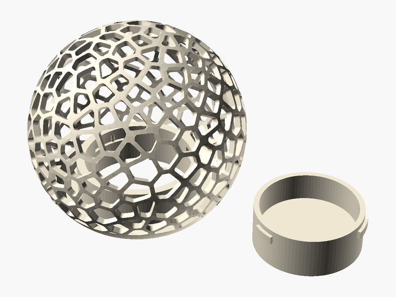

# Fungi Grower (Mushroom Grow Kit)

**Created by:** Eli

The MGS kit is used to start mushroom gardens. I made it so you can grow a garden using biodegradable materials, so nothing gets left behind in the dirt.

My product is a sphere covered in a Voronoi hole pattern, with a screw-on bottom so you can fill it with mushroom spawn and things like wood chips or coffee grounds. The holes let the mushrooms grow out.

Mushrooms help your garden grow more kinds of life.

## Printed with PHA 🌱

**What is PHA?** PHA is a plastic made by tiny microbes! They munch on plant sugars and oils and store the PHA inside their bodies, kind of like how we store energy.

**Why is it eco-friendly?** It comes from plants instead of oil. And when it's all done, it can break down back into nature (in soil, and even in the ocean) instead of hanging around for hundreds of years.

**Printing tips:**
- 🧊 **Keep it cool:** set the nozzle to about 190–200 °C.
- 💨 **Lots of air:** turn the cooling fan up high and leave the printer doors or lid open.
- 🐢 **Go a little slower:** slower prints help each layer stick and cool nicely.
- ☀️ **Keep it dry:** store the spool in a bag with a desiccant pack so it doesn't soak up water.
